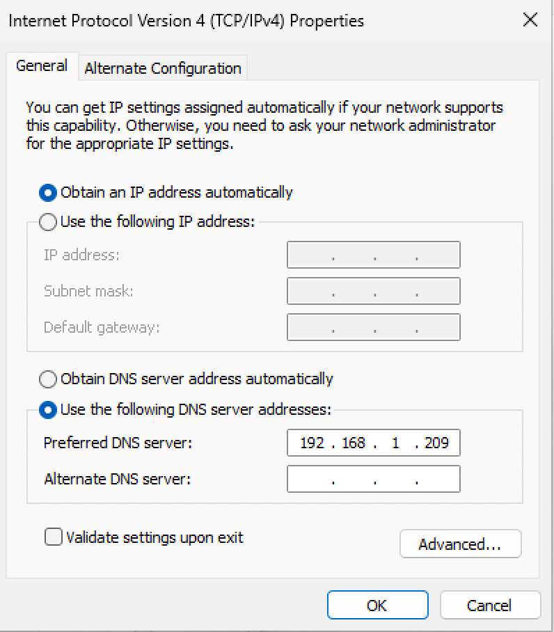
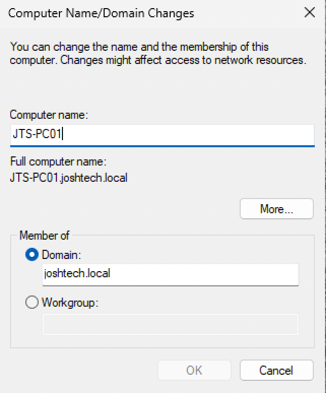
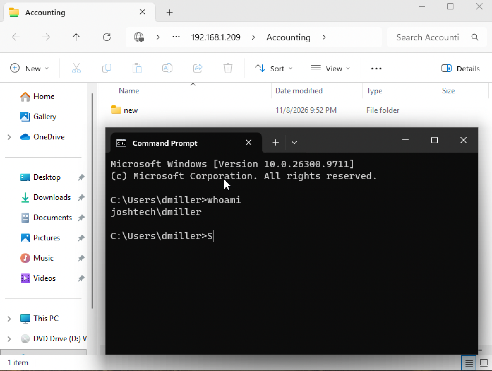
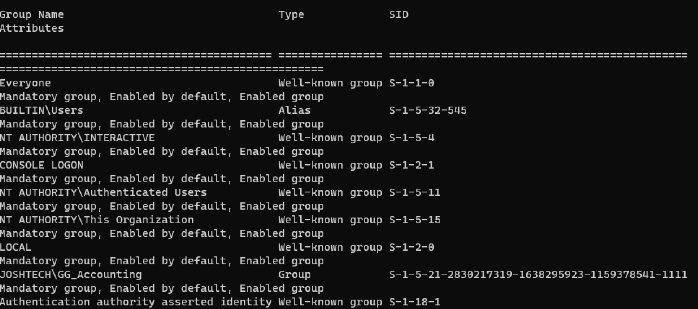
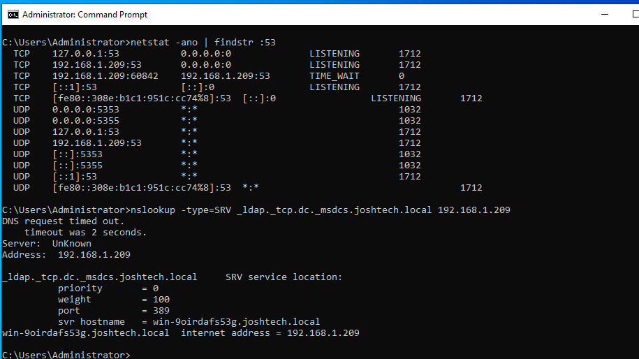
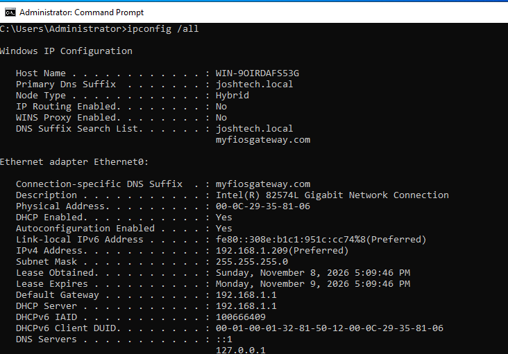

# Windows 11 Domain Join & Authentication Lab

## Introduction

This lab documents how I configured and verified a Windows 11 workstation as a member of the `joshtech.local` Active Directory domain in my JoshTech Solutions home lab. I verified the client DNS settings, domain membership, domain user sign-in, and domain controller discovery.


## Environments and Technologies Used

- VMware Workstation Pro 17
- Windows Server 2022 — Active Directory Domain Services (AD DS) and DNS
- Windows 11 — domain-joined client (`JTS-PC01`)
- Active Directory domain: `joshtech.local`
- Domain controller IP used in the lab: `192.168.1.209`

> [!NOTE]
> **Windows 11 VM Setup:** This lab requires a Windows 11 virtual machine and a Windows Server 2022 domain controller. Download the Windows 11 installation media from [Microsoft](https://www.microsoft.com/software-download/windows11) and install it using VMware Workstation or VMware Fusion, depending on your host computer.

## Lab Objectives

- Configure the Windows 11 client to query the domain controller for DNS.
- Join and verify Windows 11 membership in `joshtech.local`.
- Verify domain user identity and security group membership.
- Check that DNS advertises the domain controller's LDAP service.

## Lab Walkthrough

### 1. Configure the Windows 11 DNS server

Press **Win + R**, enter `ncpa.cpl`, then open **Ethernet → Properties → Internet Protocol Version 4 (TCP/IPv4) → Properties**. Set the **Preferred DNS server** to '192.168.1.209' "Domain Controller's IP Address" while retaining automatic IP assignment.

This directs Active Directory DNS queries to the domain controller rather than relying on a public DNS resolver.



### 2. Join the Windows 11 computer to the domain

Press **Win + R**, enter `sysdm.cpl`, then select **Computer Name → Change → Domain**. Entered `joshtech.local` **Your Domain Root Environment Name**, supply authorized domain-join credentials, and restart after a successful join.

The screenshot below verifies the completed result: computer `JTS-PC01` belongs to `joshtech.local`.



### 3. Verify domain user authentication

Sign in using a domain account, open **Command Prompt**, and run:

```cmd
whoami
```

The command identifies the currently authenticated account. In this lab, the Accounting user was `JOSHTECH\dmiller`.



### 4. Verify Active Directory security group membership

In Command Prompt, run:

```cmd
whoami /groups
```

The output includes `JOSHTECH\GG_Accounting`, confirming that the signed-in Accounting employee has that group in their access token.



### 5. Check domain controller discovery using DNS

On Windows Server, I checked the domain controller's DNS service records with:

```cmd
nslookup -type=SRV _ldap._tcp.dc._msdcs.joshtech.local 192.168.1.209
```

The SRV response identified an LDAP service for the domain controller on port `389`. The lookup also showed an initial DNS timeout, so this screenshot is evidence of successful record resolution **after a timeout**, not proof of error-free DNS responsiveness.



I also inspected the server's network configuration using `ipconfig /all`.



## Results and Key Takeaways

- Windows 11 was configured to use `192.168.1.209` as its preferred DNS server.
- `JTS-PC01` was confirmed as a member of `joshtech.local`.
- A domain account and its Accounting security group membership were verified.
- DNS returned a domain controller LDAP SRV record, although a timeout was observed.

**What I learned:** Domain membership, user authentication, and resource authorization are related but separate checks. DNS is especially important because Windows clients use it to discover Active Directory services.
